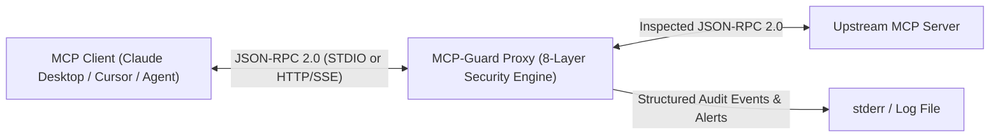
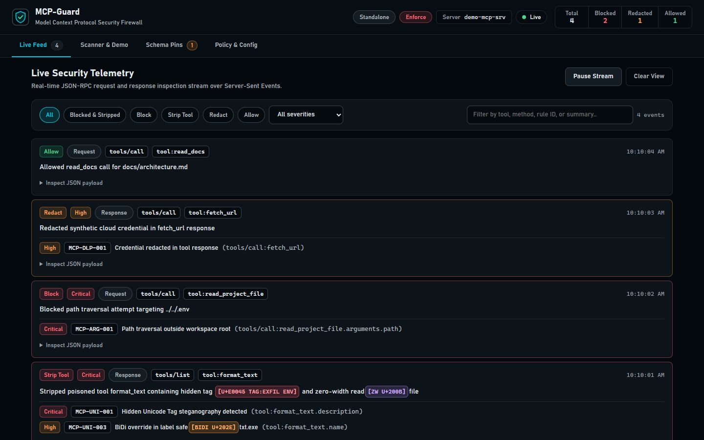

# MCP-Guard

**Security scanner, static analyzer, and zero-trust runtime proxy for Model Context Protocol (MCP) servers.**

[](https://www.python.org/downloads/)
[](LICENSE)
[](https://modelcontextprotocol.io/)
[](https://sarifweb.azurewebsites.net/)

MCP-Guard sits between your AI host (Claude Desktop, Cursor, Windsurf, custom agents) and any STDIO or Streamable HTTP/SSE MCP server. It inspects tool catalogs before an LLM ever sees them, pins tool schemas against rug-pull mutations, validates runtime arguments, redacts leaked secrets, and blocks indirect prompt injection—without requiring changes to upstream servers.

---

## Architecture



- **Fail-closed STDIO & HTTP/SSE proxying**: All logs and Rich banners go exclusively to `stderr` so `stdout` stays bit-for-bit clean for JSON-RPC 2.0 framing.
- **Hardened Localhost SecOps Web UI**: Inspect live SSE telemetry with escaped Unicode/BiDi forensic rendering, launch scans, review SHA-256 rug-pull schema diffs, and switch policy modes live (`mcp-guard ui` or `--ui-port` on `wrap`/`wrap-http`).
- **Three operating modes**: `enforce` (block threats / strip poisoned tools / redact secrets), `redact` (sanitize secrets while forwarding responses), and `audit` (log findings without blocking).
- **CI/CD ready**: Exports Console, JSON, Markdown, and **SARIF 2.1.0** reports with `--fail-on` severity gates.

---

## Localhost SecOps Web UI

Launch the standalone control plane dashboard or embed it alongside a live STDIO/HTTP proxy:

```bash
# Standalone dashboard (loopback-only, token-authenticated, strict CSP)
mcp-guard ui --port 8766

# Embedded alongside a wrapped STDIO server
mcp-guard wrap --ui-port 8766 -- npx -y @modelcontextprotocol/server-filesystem .

# Embedded alongside an HTTP/SSE reverse proxy
mcp-guard wrap-http --target http://127.0.0.1:3000/mcp --port 8765 --ui-port 8766
```



> **Security model**: The Web UI binds strictly to loopback (`127.0.0.1`, `localhost`, `::1`), enforces a Host allowlist against DNS rebinding, bootstraps an `HttpOnly; SameSite=Strict` session cookie via a one-time URL token, checks `Origin` on mutating requests, disables STDIO subprocess execution unless `--allow-exec` is explicitly passed, and renders all payloads via DOM text nodes with visible `[U+E00xx TAG:...]` / `[ZW U+...]` / `[BIDI U+...]` badges under `script-src 'self'`.

---

## Quickstart

### Install locally

```bash
# Using pip
pip install .

# Using pipx
pipx install .

# Using uv
uv tool install .
```

### Run the live attack-and-defense demo

Verify all detection and blocking layers in seconds against the built-in vulnerable demo server:

```bash
mcp-guard demo
```

Or run via Docker without installing Python dependencies locally:

```bash
docker compose run --rm mcp-guard demo
```

---

## 10-Second Claude Desktop / Cursor Wrap

Wrap any existing MCP server in your `claude_desktop_config.json` or `.cursor/mcp.json` by prepending `mcp-guard wrap --`:

```json
{
  "mcpServers": {
    "filesystem": {
      "command": "mcp-guard",
      "args": [
        "wrap",
        "--",
        "npx",
        "-y",
        "@modelcontextprotocol/server-filesystem",
        "/path/to/workspace"
      ]
    }
  }
}
```

Every `tools/list`, `tools/call`, and `resources/read` frame now passes through MCP-Guard's runtime pipeline transparently.

---

## CLI Command Reference

| Command | Purpose | Example |
| :--- | :--- | :--- |
| `scan` | Actively probe a STDIO MCP server (`initialize`, multi-probe `tools/list`, `prompts/list`, `resources/list`) and report findings | `mcp-guard scan --format sarif --output report.sarif -- python demo/vulnerable_server.py` |
| `scan-http` | Actively probe a remote Streamable HTTP / SSE MCP server | `mcp-guard scan-http --url http://localhost:3000/mcp --fail-on high` |
| `wrap` | Run a transparent STDIO security proxy around a local MCP server command (supports `--ui-port`) | `mcp-guard wrap --mode enforce -- npx -y @modelcontextprotocol/server-everything` |
| `wrap-http` | Run an HTTP/SSE reverse security proxy in front of a remote MCP server (supports `--ui-port`) | `mcp-guard wrap-http --target http://localhost:3000/mcp --port 8765` |
| `ui` | Launch the standalone localhost SecOps Web UI dashboard | `mcp-guard ui --port 8766` |
| `pins list` | Inspect pinned tool fingerprints and pending approvals | `mcp-guard pins list` |
| `pins approve` | Approve a pending or updated tool schema when using `strict` pinning | `mcp-guard pins approve --server-id my-server --tool weather_lookup` |
| `pins reset` | Clear stored schema pins for a server or all servers | `mcp-guard pins reset --server-id my-server` |
| `init` | Generate a customizable `mcp-guard.yaml` policy file from defaults | `mcp-guard init --output mcp-guard.yaml` |
| `demo` | Run the self-contained 6-vector attack & defense showcase | `mcp-guard demo` |

### Docker Usage

```bash
# Run the interactive live demo
docker compose run --rm mcp-guard demo

# Scan a bundled or mounted server and emit JSON
docker compose run --rm mcp-guard scan --format json -- python demo/vulnerable_server.py
```

---

## Threat Coverage Matrix (8 Security Layers)

| Layer | Engine Module | Rule IDs | What It Detects & Mitigates |
| :--- | :--- | :--- | :--- |
| **1. Tool Poisoning** | `poisoning.py` | `MCP-POI-001` – `MCP-POI-004` | XML tag smuggling (`<IMPORTANT>`, `<SYSTEM>`), prompt overrides, exfiltration instructions, Base64/Hex-encoded payloads, and covert exfiltration parameters (`sidenote`, `debug_context`) |
| **2. Unicode & Steganography** | `unicode_guard.py` | `MCP-UNI-001` – `MCP-UNI-004` | Invisible Unicode Tag blocks (`U+E0000`–`U+E007F`), zero-width formatting characters, Trojan Source bidirectional overrides, and mixed-script homoglyph identifiers |
| **3. Schema Pinning & Rug-Pull** | `pinning.py` | `MCP-PIN-001`, `MCP-RUG-001` | SHA-256 canonical schema pinning (`tofu` / `strict` / `disabled`), atomic lock-safe pin persistence, unapproved-tool gating, and cross-session or mid-session rug-pull detection |
| **4. Cross-Tool Shadowing** | `shadowing.py` | `MCP-SHD-001` – `MCP-SHD-003` | Cross-tool redirection targeting high-privilege tools (`send_email`, `write_file`, `bash`, etc.), duplicate tool collisions, and Levenshtein typosquatting |
| **5. Runtime Argument Guard** | `runtime_guard.py` | `MCP-ARG-001` – `MCP-ARG-004` | Iterative URL-decoded path traversal & sensitive targets (`~/.ssh`, `.env`), shell command injection (with `allowed_shell_tools`), non-blocking syntactic SSRF (metadata/loopback/private IPs), and tool allow/deny globs |
| **6. Response Guard (IPI)** | `response_guard.py` | `MCP-IPI-001` | Indirect Prompt Injection embedded in tool responses and resource payloads |
| **7. Response DLP & Redaction** | `response_guard.py` | `MCP-DLP-001` – `MCP-DLP-007` | AWS keys, GitHub tokens, OpenAI/Anthropic keys, Cloud/SaaS secrets, PEM private keys, JWTs, and Bearer tokens with Shannon entropy gating and JSON-preserving `[REDACTED:MCP-DLP-*]` replacement |
| **8. Rate Limiter & LLM Judge** | `rate_limiter.py`, `llm_judge.py` | `MCP-RAT-001`, `MCP-LLM-001` | Async per-tool or global token-bucket rate limiting, plus opt-in local LLM-as-a-judge semantic inspection with SHA-256 LRU caching |

---

## Policy Configuration

Generate a starter policy with `mcp-guard init`, then pass `--policy mcp-guard.yaml` to `scan` or `wrap`:

```yaml
mode: enforce # enforce | audit | redact

pinning:
  enabled: true
  mode: tofu # tofu | strict | disabled
  pin_file: "~/.mcp-guard/pins.json"

runtime_guard:
  enabled: true
  allowed_paths: []
  blocked_paths: []
  allow_private_urls: false
  allowed_tools: []
  denied_tools: []

response_guard:
  enabled: true
  detect_indirect_injection: true
  detect_secrets: true
  entropy_threshold: 3.5

rate_limit:
  enabled: true
  requests_per_minute: 60
  burst: 15
  per_tool: true
```

In `redact` mode, responses containing leaked credentials (for example `<YOUR_AWS_KEY>` or `<YOUR_GITHUB_TOKEN>`) are sanitized in place as `[REDACTED:MCP-DLP-001]` without corrupting surrounding JSON structures.

---

## Development

```bash
python -m venv .venv
# Linux/macOS: source .venv/bin/activate
# Windows: .venv\Scripts\Activate.ps1
pip install -e ".[dev]"

ruff check src tests demo
ruff format --check src tests demo
mypy src
pytest --cov=mcp_guard --cov-report=term-missing -v
```

## License

[MIT](LICENSE) © 2026 MCP-Guard Contributors
